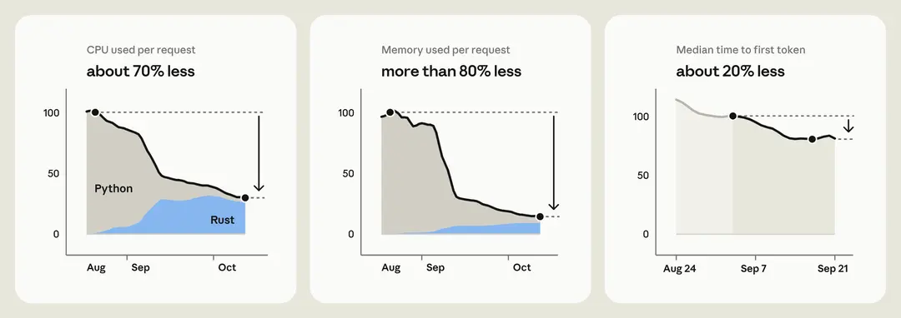
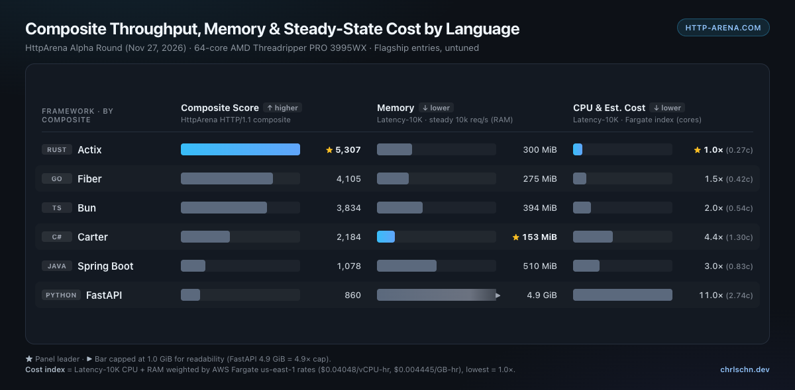
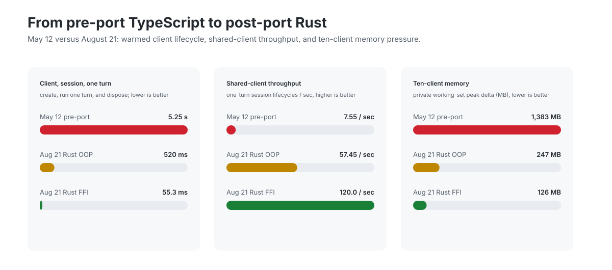

----

2026 is likely the beginning of the end of Python (and other interpreted languages) for large scale production backends.

Programming languages are ultimately human abstractions to transform human-space processes into instructions for a machine to execute.  They have proliferated, aligning to the different ways we model and translate ideas in our heads into running software that gets deployed onto a machine.  There has always been a tradeoff to "easy" and low-ceremony languages like Python or JavaScript versus more "complex", compiled languages like C/C++, Rust, Java, or even C#.

But that calculus is changing as we approach the end of Year One of agentic programming: *the future of code is no longer human written*.

## Throughput, Capacity, and Cost Savings at Scale

The crux of the problem is that Python is not a particularly efficient language and runtime to operate at scale.

Anthropic states it directly in the opening of their research blog post *[Migrating our Messages API to Rust](https://www.anthropic.com/research/migrating-api-to-rust)*

> From early 2024 to fall 2026, API traffic grew roughly 1,800 times. Rust would allow us to use far less CPU per request.
>
> We built the Messages API in 2023 and wrote it in Python, which was widely used internally for much of our research code. At first, it was simple.
>
> This calculus gradually began to change. By late 2025, every Messages API request had to be validated, converted into the prompt, tokenized, and screened by our safety classifiers. As each reply arrived, the stream of tokens had to be sorted into text, thinking, and tool calls, and Python added overhead to every one of those steps each time it created an object, freed memory, or handed its work to the next task. Traffic eventually grew far beyond what the initial Python service was built for, and we quickly needed to find a way to make the service much more efficient.

Their charts speak for themselves:

*From Anthropic's blog post*

It is the case that, in many instances, the clean rewrite itself is responsible for performance improvement as a team sheds tech debt and right-at-the-time decisions, but [HTTP Arena offers another perspective on this](https://http-arena.com):

 Profile | Actix (Rust) | Fiber (Go) | Bun (TS) | Carter (.NET) | Spring Boot (Java) | FastAPI (Python) |
| --- | --- | --- | --- | --- | --- | --- |
| **Composite (rescaled)** | **6,436** | 5,012 | 4,750 | 2,649 | 1,292 | 1,032 |
| **Baseline** (4,096 conns) | **2,905,625**, 2.46ms 384 MiB | 2,623,678, 3.47ms 348 MiB | 1,926,386, 3.84ms 1.2 GiB | 1,398,551, 7.62ms ***344 MiB*** | 259,473, 16.10ms 2.5 GiB | 298,664, 21.30ms 4.9 GiB |
| **Short-lived** (4,096 conns) | 1,144,727, 9.27ms 298 MiB | **2,062,489**, 6.96ms 892 MiB | 1,672,444, 8.61ms 1.1 GiB | 460,816, 12.30ms ***117 MiB*** | 208,860, 18.20ms 2.4 GiB | 273,929, 79.20ms 6.2 GiB |
| **Async Delay** (32,000 conns) | **2,014,158**, 16.70ms 1.1 GiB | 1,519,042, 30.60ms ***1.0 GiB*** | 1,949,532, 22.30ms 1.5 GiB | 942,839, 85.80ms 1.4 GiB | 19,167, 1.11s 1.3 GiB | 190,420, 284.60ms 6.0 GiB |
| **JSON Comp** (4,096 conns) | **586,605**, 27.20ms 619 MiB | 290,414, 41.40ms 804 MiB | 460,716, 20.90ms 1.1 GiB | 395,625, 36.00ms ***573 MiB*** | 198,628, 20.10ms 2.4 GiB | 101,178, 537.40ms 5.1 GiB |
| **JSON Comp** (16,384 conns) | **573,534**, 56.50ms 1,016 MiB | 288,805, 94.00ms 1.6 GiB | 460,816, 61.00ms 1.1 GiB | 382,893, 67.60ms ***856 MiB*** | 183,986, 55.90ms 2.6 GiB | 98,959, 717.50ms 5.2 GiB |
| **JSON TLS** (4,096 conns) | **1,346,577**, 65.46ms ***434 MiB*** | 902,093, 106.82ms 722 MiB | 1,081,708, 41.48ms 966 MiB | 566,579, 130.50ms 878 MiB | 188,030, - 3.2 GiB | 133,489, 131.52ms 5.1 GiB |

*(Caveat: the async numbers for C# are likely to improve once we see [C#'s runtime async](https://learn.microsoft.com/en-us/dotnet/core/whats-new/dotnet-11/runtime#runtime-async) mature)*

| Latency-10K | Actix (Rust) | Fiber (Go) | Bun (TS) | Carter (.NET) | Spring Boot (Java) | FastAPI (Python) |
| --- | --- | --- | --- | --- | --- | --- |
| **Score** | **81.8** | 69.3 | 62.7 | 49.7 | 50.4 | 28.6 |
| **p99** | 107us | **106us** | 125us | 118us | 184us | 590us |
| **CPU** | **26.6%** (~0.3 cores) | 41.8% (~0.4 cores) | 54.0% (~0.5 cores) | 130.2% (~1.3 cores) | 82.9% (~0.8 cores) | 274.3% (~2.7 cores) |
| **RAM** | 300 MiB | 275 MiB | 394 MiB | ***153 MiB*** | 510 MiB | 4.9 GiB |

*Visualizing the delta in; C# surprisingly holds quite well and shockingly leads in memory efficiency.*

It's damning; teams building for production backend systems that are going to handle high volumes will pay not only a significant overhead on the infrastructure capacity, *but also deliver poor performance* at high throughput.  Suggesting Python for building production backends for any greenfield projects in 2027 ***will be seen as a mistake*** through hindsight and, I suspect, lead to more rewrites.

## Is this Isolated?

This isn't isolated to Python.  [Microsoft's Copilot SDK was recently re-written as well from TypeScript *on Node* to Rust](https://github.blog/ai-and-ml/generative-ai/migrating-the-github-copilot-runtime-to-rust-using-copilot/) and saw similar gains.

*Via GitHub's blog post*

While not a backend and with different motivations, the end result is the same: lower memory usage, higher throughput, and faster response moving from a runtime interpreted language.

## The Correctness Angle and the Inner Loop

As teams move towards agents writing the majority of the code, the "inner loop" of agent coding has come into focus.

The Anthropic blog post talks about this a bit (though at a higher level), but the gist of it is that there is a limited set of tools for agents to verify the correctness of the code they produce.  Anthropic calls this ***"the generator-verifier gap"***.  The objective is to close this gap by making it easier for the agent to verify its own output.

To that end, there is mounting body of evidence that ***types*** are a key element of [an agent-friendly codebase](https://chrlschn.dev/blog/2026/09/foundations-of-agent-friendly-codebases/).

***[Why AI is pushing developers toward typed languages](https://github.blog/ai-and-ml/llms/why-ai-is-pushing-developers-toward-typed-languages/)***

> With AI tools and agents producing larger volumes of code and features than ever, it only makes sense that reliability is more critical. And… that is where typed languages win the debate. Not because untyped languages are “bad,” but because <u>types catch the exact class of surprises that AI-generated code can sometimes introduce</u>.

***[Language Plasticity is More Important Than Ever](https://blog.dlang.org/2026/08/10/language-plasticity-is-more-important-than-ever/)***

> Dynamic languages shine for rapid iteration, but their flexibility can demand extra tokens from the LLM. In duck-typed environments like Python or JavaScript, a variable’s behavior emerges only through usage. When an LLM builds context, it often needs surrounding code, comments, or explicit hints to infer “this variable quacks like a list here, but might be something else later.”
>
> Statically typed languages flip the script. In D, a parameter declared as int[] arr or a struct with explicit methods tells the model exactly what operations are valid, right there in the signature. No detective tokens required.
>
> <u>The result? When using LLMs with duck-typed languages, the model often spends more tokens reconstructing intent. Explicit types and consistent call-site semantics in D let it focus on logic instead of inference.</u>

***[Strongly Typed Languages Yield Lower Perplexity in Code Completion Across Eighteen Models](https://bioengineer.org/strongly-typed-languages-yield-lower-perplexity-in-code-completion-across-eighteen-models/)***

> In an extensive empirical investigation into how automated software engineering tools process source code, researchers have demonstrated that large language models exhibit systematically higher confidence when predicting tokens in strongly typed programming languages than in dynamically typed scripting languages.
>
> By analyzing a curated, balanced corpus of 2,254 source files harvested from 881 open-source GitHub projects, the authors established that languages enforcing formal type disciplines, most notably <u>Java, Go, and C#, consistently yield lower perplexity scores than flexible scripting environments such as Perl, Ruby, and Shell</u>.

As teams start to focus more on the agentic inner loop, we will see types become more important and typed languages will become the norm simply because it's another tool for the agent.

## What I'm NOT Saying...

I'm certain that the above may read as controversial or sacrilegious to many, but I'm NOT saying that Python is done for.

It will continue to see usage as a powerful scripting language and continue to be used heavily in ML and data science because of the large body of tooling that exists here.

But adopting Python for large scale, production backends in 2027 will not be a wise choice and will almost certainly be looked back upon as a mistake.

## What's the Alternative?

I think that for *serious* engineering orgs, *you should probably go with Rust*; the gains to be had are undeniable, especially if you do not plan on minimally reading the code or not reading the code at all.

For everyone else?  ***I think C# is an underrated contender*** (yes, I'm biased 😅).

While it can't top Rust or Go in raw performance, it is competitive and offers some niceties that are worth considering:

- [GitHub's 2020 State of the Octoverse report](https://octoverse.github.com/2020/) showed that .NET's Nuget package ecosystem has the least number of detected vulnerabilities in active GH repos and C# projects tend to have the lowest number of transitive dependencies.  Teams that have used .NET will find this obvious: Microsoft themselves ship a very, very large first-party ecosystem.  This becomes more important as AI accelerates software exploits; having a professional team managing and triaging issues is a boon.
- "Modern" C# and .NET have been very stable now for ~a decade since the .NET Framework and .NET Core split.  The language has largely retained backwards compatibility while delivering very nice syntactic sugar release after release that has made the language more terse.
- C#'s compiler API, Roslyn, is a bit unique in that [it is written in C#](https://github.com/dotnet/roslyn).  It is possible to write sophisticated [static analyzers](https://learn.microsoft.com/en-us/visualstudio/code-quality/roslyn-analyzers-overview?view=visualstudio) using C# that add signal to verification and close the generator-verifier gap.
- [Source generators](https://www.codemag.com/Article/2305061/Writing-Code-to-Generate-Code-in-C) also make use of the Roslyn APIs to dynamically generate code, reducing boilerplate and "perplexity" along the way by increasing the semantic signal of the code.
- Entity Framework Core ("EF Core") adds to the verification story by allowing agents to generate typed queries.  It is very mature at this point, performs almost as well as raw SQL in most common CRUD cases, and is still flexible enough for raw SQL when needed
- For teams already comfortable reading TypeScript and still plan to apply human review to code, *[TypeScript is like C#](https://typescript-is-like-csharp.chrlschn.dev/)*; both are can credit Anders Hejlsberg for their creation.
- CSharpRepl is a pretty incredible agent verification tool [because it can be injected into a running .NET application](https://fuqua.io/blog/2026/06/injecting-a-csharp-repl-into-a-running-net-process/).  I think this is hard for folks to grasp at first blush, but it effectively lets an agent modify *the running behavior of an application* without losing state.  It provides the agent an insanely powerful tool that can wrap or replace runtime code as it experiments, verifies, or performs diagnosis.

----

## Closing Thoughts

While languages like Python, JavaScript, and Ruby have traditionally biased for simplicity, flexibility, speed of human authoring, and human ergonomics, the tradeoff is higher operating costs at scale as a result of the nature of the languages and runtimes.  Teams starting greenfield backend or considering a target language for an AI re-write should seriously do the calculus on which language and platform to target once human authoring is removed from the process.

As we look forward, it is likely that ***more and more application backends will actually shift into HTTP-based MCP servers***...*which are just web backends*.  Here, teams should seriously consider whether a language and runtime like Python is the right operational choice for the future.

Rust has established itself as a prime target for engineering teams that have already decided to forgo human code review or have deep Rust expertise already.

C# is a surprisingly effective (and underrated) alternative (see above), especially for organizations that value the enterprise support and investment from Microsoft with broad coverage from first-party maintained standard libraries.
